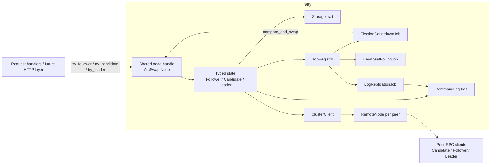
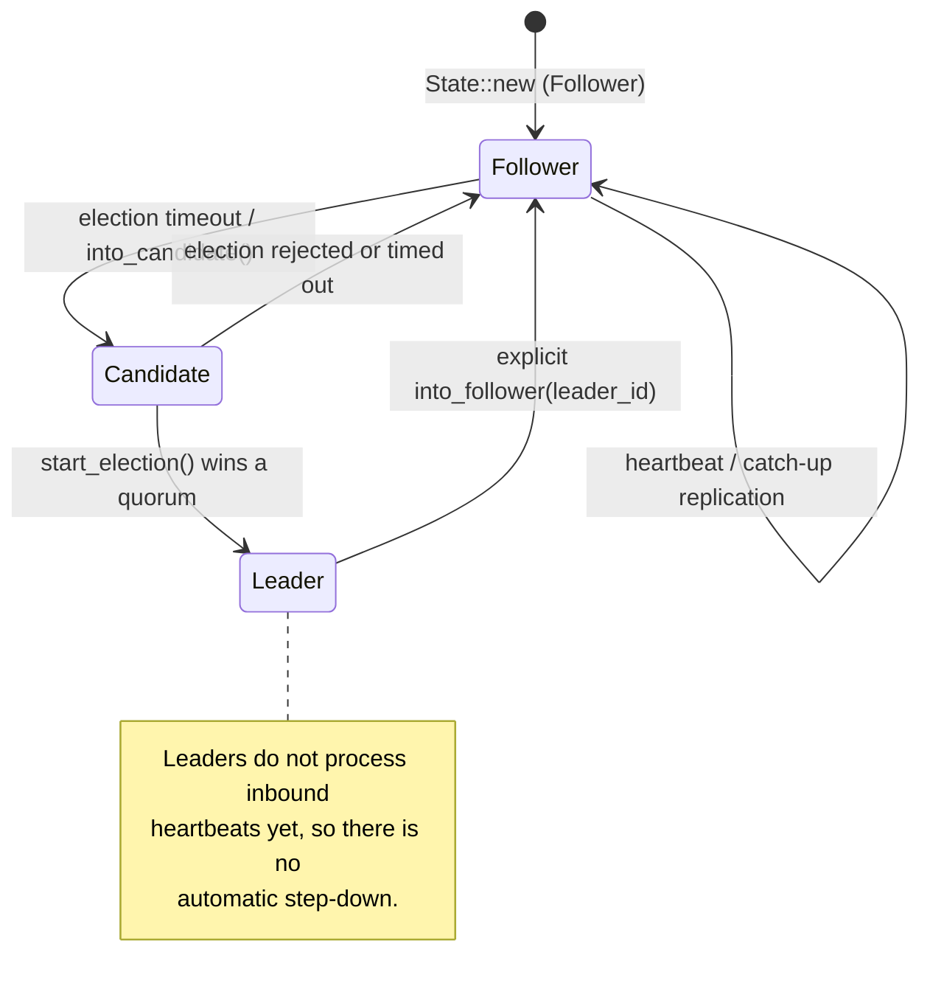
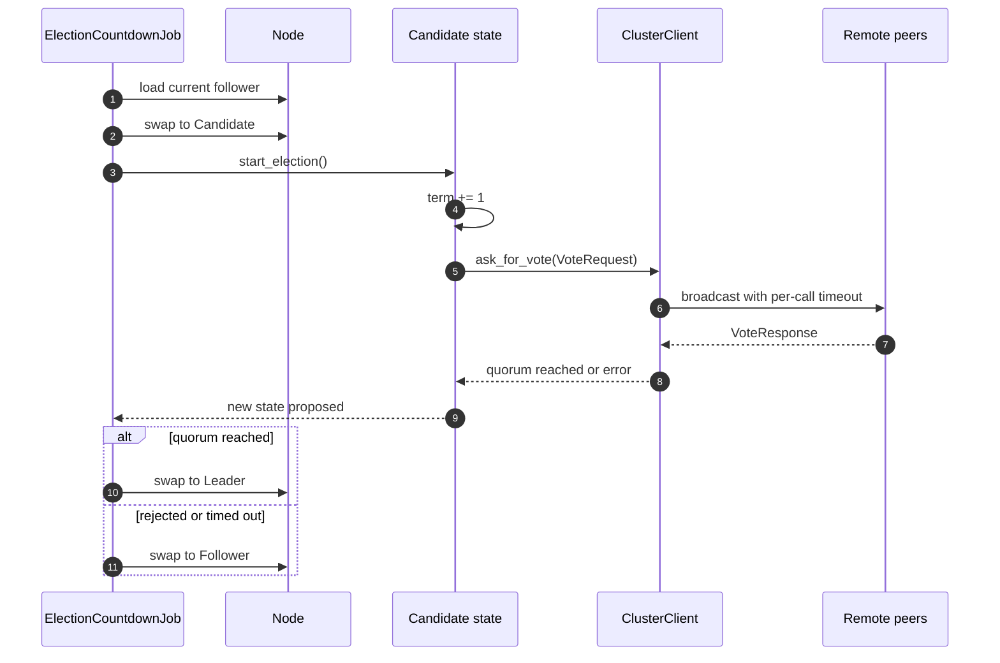
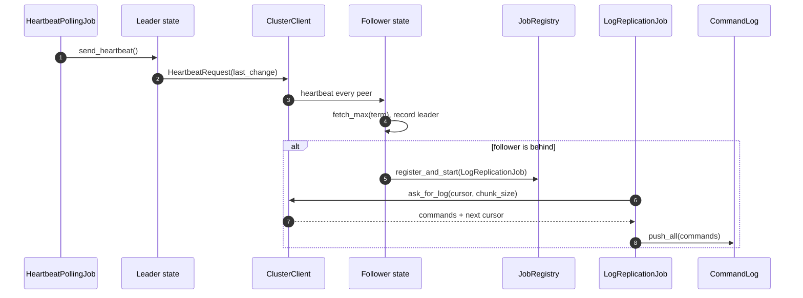
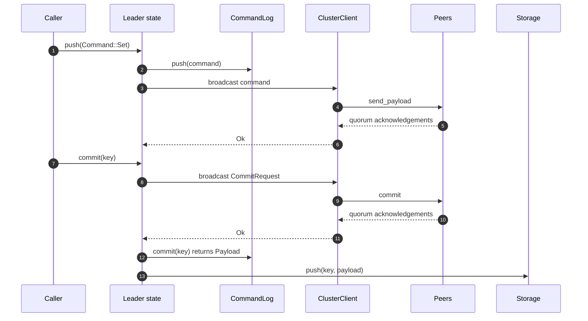

# rafty

`rafty` is an asynchronous Rust library that implements the consensus core of the
[Raft](https://thesecretlivesofdata.com/raft/) algorithm: leader election, heartbeats, quorum RPCs, log
replication, and application of committed commands to storage.

The crate is deliberately **request-unaware**. It knows about node roles, terms, peers, a
replicated command log, materialized storage, and the background jobs that drive them. It knows
nothing about HTTP, client sessions, dependency injection, or a particular serialization format.
A server such as an HTTP layer is expected to own the `Node` handle, narrow it to the current role,
and call the appropriate consensus operations.

> **Status: early prototype.** This is library-only code. The `CommandLog` and `Storage`
> implementations are stubs, there is no network transport, persistence, cluster configuration
> loader, or binary in this checkout. See [Current limitations](#current-limitations) before
> relying on it for anything durable.

## How Raft is modelled here

A Raft cluster keeps a replicated log consistent by electing a single leader for a term and having
that leader replicate commands to a quorum of followers. The implementation is split into three
ideas:

1. **A typed state machine.** Each node is in exactly one role, and each role exposes only the
   operations that are valid in it. Invalid transitions are rejected by the type system or by the
   `Node` narrowing methods.
2. **A shared node handle.** The current state should live behind any container, which provides
   atomic replacements of the state, so request handlers can read it without a lock while
   background jobs replace it. On way to achieve that is to use `ArcSwap` struct from
   [arc-swap](https://crates.io/crates/arc-swap) crate.
3. **Registry-driven background work.** Timers are not hidden inside the node. They are `Job`s
   owned by a `JobRegistry`; each job executes one bounded unit of work when the registry says so.
   The registry owns the task, the timers, and cancellation.



### Roles and typed states

`State<S>` carries:
- the node identity;
- the cluster client;
- the log;
- the storage;
- the job registry;
- and the current term.

`S` is one of the sealed marker types `Follower`, `Candidate`, or `Leader`.
Only operations that make sense in that role are implemented, so the compiler prevents, for
example, sending a leader heartbeat from a follower state.

`Node` is the erased, publicly matchable union of the three states. It is the handle stored in
atomic container like `ArcSwap`; callers narrow it before acting:

```rust
let leader = node.load().try_leader()?;
leader.push(command).await?;
```



A node is always constructed as a `Follower`; the other states are reached through
transitions. The transition consumes `self` and returns the next typed state, reusing the same
`node_id`, shared `term`, `log`, `storage`, `cluster client`, and `job` `registry`.

### Terms and elections

The term is an `Arc<AtomicU64>` shared by every state derived from the same node, so advancing it
through one handle is immediately visible through the others. It starts at zero.

An election works as follows:

- `State<Candidate>::start_election` increments the term once and broadcasts `VoteRequest` to the
  configured peers with a fixed 500 ms timeout.
- A peer grants a vote when the requested term is higher than its current term; a vote in the same
  or an older term is denied. Unknown candidates are rejected without touching the term.
- If enough peers voted for the same candidate, node transitions to a `State<Leader>`. Otherwise it returns to a
  `State<Follower>` with no known leader, and the election may be retried by the countdown job.
  Leader assigned later with subsequent `heartbeat` messages



The timeout that triggers an election is owned by `ElectionCountdownJob`, not by the state
machine. Its delay is redrawn from a range on every reset (`AfterQuiet` trigger), which is how
split votes are reduced.

### Heartbeats and catch-up replication

A leader periodically broadcasts a `HeartbeatRequest` containing its last changed timestamp. A
follower merges the term upwards, records the sender as leader when appropriate, and compares the
leader's cursor with its own log. If the follower is behind, it registers a one-shot
`LogReplicationJob` that pulls commands from the leader in chunks until the cursor stops moving.



Heartbeats are sent to **all** configured peers and awaits response from them; ordinary writes,
  commits, and votes are sent to all peers as well, but it awaits only for a successful responses,
  which are enough for quorum. The replication job stops when the cursor stops advancing, and it
  gives up on a failed request. A later heartbeat can schedule it again.

### Writes and commits [WIP]

`push` appends a write or modify command to the log and broadcasts it. `commit` asks the peers to
acknowledge the key, then applies the committed payload to storage. Reads are classified by
`CommandType`, but a `Get` is a no-op in the push path and the state API does not expose a read
operation yet.



A follower has the same `push` and `commit` methods for local wiring, but they do not forward
anything to the leader in the current implementation. In a cluster, writes must be routed to the
leader by the server layer.

### Timestamp-based log [WIP]

The current log uses `DateTime<Utc>` as its cursor instead of Raft's `(index, term)` pair:

- `CommandLog::get_last_change` returns the timestamp of the latest entry.
- A `HeartbeatRequest` carries the leader's latest timestamp.
- `LogReplicationRequest { cursor_from, chunk_size }` asks for entries after a cursor.
- `LogReplicationResponse { cursor_id, commands }` returns the next cursor.

This keeps the prototype small and makes catch-up easy to express, but it does not yet provide
Raft's log matching property, per-entry terms, a commit index, or conflict/truncation handling.
Those are important for a production implementation; see the limitations below.

### Jobs

A `Job` is a listener for a `Trigger`, not a task that loops forever:

```rust
#[async_trait]
pub trait Job: Debug + Send + Sync + 'static {
    async fn execute(&self) -> Control;
    fn key(&self) -> JobKey;
    fn trigger(&self) -> Trigger;
}
```

- `Control::Continue` asks the registry to schedule the next execution.
- `Control::Done` ends the driver loop. A `Trigger::Once` job always ends after one execution.
- `Trigger::Once` runs immediately.
- `Trigger::Every(period)` runs immediately and then every period.
- `Trigger::AfterQuiet(range)` waits for a random duration in `range`; `JobRegistry::reset`
  redraws the deadline. This is the election countdown trigger.

Jobs must not spawn detached tasks or block forever: `JobRegistry::stop` aborts the driver task
and waits for it, and the registry must remain the owner of timers and cancellation.

### Peer RPC and quorum

`RemoteNode` bundles one transport client per role:

- `CandidateClient::ask_for_vote`
- `FollowerClient::request_log`
- `LeaderClient::send_payload`, `commit`, and `heartbeat`

`ClusterClient` fans a broadcast request out to the peer map, applies a per-call timeout, and stops
as soon as enough responses satisfy the operation's predicate. For writes, commits, and votes, the
quorum predicate is `successful_remote_calls * 2 >= remote_nodes.len()`; this assumes the map
contains the peers but **not** the local node. An empty or self-only map short-circuits to success,
which makes a single-node cluster usable.

## Components at a glance

| Module | Contents |
| --- | --- |
| `node_state` | `NodeId`, `Node`, `State<S>`, and the sealed `Follower`, `Candidate`, `Leader` states. The state machine and role-scoped operations live here. |
| `job` | `Job`, `JobKey`, `Trigger`, `Control`, `JobRegistry`, plus `ElectionCountdownJob`, `HeartbeatPollingJob`, and `LogReplicationJob`. |
| `remote_node` | `RemoteNode`, `ClusterClient`, and the `CandidateClient` / `FollowerClient` / `LeaderClient` transport traits. |
| `transport::model` | `ClusterMessage<T>`, `Metadata`, `NodeAware`, `Key`, and the command, heartbeat, commit, log, and vote payloads. |
| `log` | The `CommandLog` trait and an unimplemented `InMemoryCommandLog`. |
| `storage` | The `Storage` trait and an unimplemented `InMemoryStorage`. |

Wire types:

- `ClusterMessage<T> { metadata: Metadata { node_id, term }, payload: T }` is the envelope for
  every RPC. It dereferences to its payload.
- `Command`s are classified by `CommandType`:
  - `Write`:
    - `Set`
    - `Delete`
  - `Modify`:
    - `Commit`
    - `Update`
  - `Read`:
    - `Get`
- `Payload` is `Integer`, `Float`, `String`, `DateTime`, or `Object` (WIP).
- `Key` and `NodeId` are cheap `Arc<str>` wrappers.

## Usage

The crate exposes traits for its external dependencies and in-memory implementations. To customize
  library for personal needs, several traits provided:

1. a `CommandLog` trait;
2. a `Storage` trait;
3. per-peer transport client traits (`CandidateClient`, `FollowerClient`, `LeaderClient`);
  the three role traits;
4. a Tokio runtime (or `JobRegistry` can own one).

The integration tests use small in-memory fakes for all of these;
[`tests/support/mod.rs`](tests/support/mod.rs) is the best working reference.

### 1. Implement the log and storage ports

```rust
pub trait CommandLog: Debug + Send + Sync {
    fn push(&self, cmd: Command) -> Result<()>;
    fn push_all(&self, cmds: Vec<Command>) -> Result<()>;
    fn commit(&self, key: Key) -> Result<Payload>;
    fn get_commands(&self, since: DateTime<Utc>) -> Result<Vec<Command>>;
    fn get_last_change(&self) -> Option<DateTime<Utc>>;
}

pub trait Storage: Debug + Send + Sync {
    fn push(&self, key: Key, payload: Payload) -> Result<()>;
    fn get(&self, key: Key) -> Result<Option<Payload>>;
}
```

`CommandLog` is the replicated, ordered command history. `Storage` is the materialized key-value
state that `commit` applies to. The provided `InMemoryCommandLog` and `InMemoryStorage` are
placeholders whose methods call `todo!()`; do not instantiate them expecting them to work at current stage (WIP).

### 2. Build the cluster client

```rust
use std::collections::HashMap;
use std::sync::Arc;
use std::time::Duration;

use rafty::node_state::NodeId;
use rafty::remote_node::{ClusterClient, RemoteNode};

// `vote_client`, `log_client`, and `leader_client` are your transport
// implementations of CandidateClient, FollowerClient, and LeaderClient.
let peer_node = RemoteNode::new(vote_client, log_client, leader_client);

let cluster = Arc::new(ClusterClient::new(
    NodeId::new("current_node"),
    Arc::new(HashMap::from([(NodeId::new("peer_node"), peer_node)])),
    Duration::from_millis(100), // per-RPC timeout
));
```

The peer map contains the other nodes only. Keep the local node out of it; the quorum calculation
expects that.

### 3. Create the node state

```rust
use arc_swap::ArcSwap;
use rafty::job::registry::JobRegistry;
use rafty::node_state::{Node, NodeId, State, states::Follower};

// Use the same registry instance the state will use: a follower registers
// its log-replication job through it.
let jobs = Arc::new(JobRegistry::from_current());

let log = Arc::new(KvLog::default());         // your CommandLog from step 1
let storage = Arc::new(KvStorage::default()); // your Storage from step 1

// All nodes start as followers. The type argument is required because the
// state parameter cannot be inferred from the constructor arguments.
let follower = State::<Follower>::new(
    NodeId::new("node1"),
    cluster,
    log,
    storage.clone(),
    Arc::clone(&jobs),
);

let node = ArcSwap::from_pointee(Node::Follower(follower));
```

`JobRegistry::from_current()` uses the current Tokio runtime and panics if called outside one. Use
`JobRegistry::new(runtime)` if the registry should own a runtime instead.

### 4. Start the election countdown

```rust
use rafty::job::election_countdown::ElectionCountdownJob;

// Follower: random election timeout, redrawn on every reset.
let timeout = (Duration::from_millis(150)..=Duration::from_millis(300)).into();
jobs.register_and_start(Arc::new(ElectionCountdownJob::with_timeout_range(
    timeout,
    Arc::clone(&node),
)));
```

### 5. Run an election and switch to leader jobs

`ElectionCountdownJob` performs this sequence on timeout. The explicit form is useful when wiring
a node or writing tests:

```rust
use rafty::job::heartbeat_polling::HeartbeatPollingJob;
use rafty::job::registry::JobKey;
use rafty::node_state::Node;

let follower = node.load().try_follower(None)?;
let candidate = follower.into_candidate();

let leader = match candidate.start_election().await {
    Ok(leader) => leader,
    Err(follower) => {
        // No quorum: keep serving as a follower with no known leader.
        node.store(Arc::new(Node::Follower(follower)));
        return Ok(());
    }
};

node.store(Arc::new(Node::Leader(leader.clone())));

// The caller owns the role-change orchestration.
jobs.stop(JobKey::HeartbeatCountdown).await;
jobs.register_and_start(Arc::new(HeartbeatPollingJob::new(
    Duration::from_millis(50),
    Arc::new(leader),
)));
```

`start_election` returns `Result<State<Leader>, State<Follower>>`: the error value is the recovered
follower state, not an `anyhow::Error`. That is why it is handled with a `match` rather than `?`.

Conversely, when a leader steps down, stop `JobKey::HeartbeatPush` and start a fresh countdown.
Role changes do not rewire jobs automatically (WIP); that orchestration belongs to the caller.

### 6. Write and commit through a leader

```rust
use chrono::Utc;
use rafty::storage::Storage;
use rafty::transport::model::Key;
use rafty::transport::model::command::{Command, Payload};

// Narrow first, then call the operation. `try_leader` returns a clone of
// State<Leader>, so no ArcSwap guard is held across the await.
let leader = node.load().try_leader()?;
let key = Key::new("greeting");

leader
    .push(Command::Set(
        key.clone(),
        Payload::String("hello".into()),
        Utc::now(),
    ))
    .await?;

leader.commit(key).await?;

// Reads are not exposed by State yet: query the materialized Storage directly.
let value = storage.get(Key::new("greeting"))?;
```

`push` logs locally before broadcasting; if the broadcast fails, the command is already in the
log. `commit` broadcasts the commit before applying it locally. The write path has no retries or
rollback; (WIP) both behaviours are prototype-level, not the final consistency story.

### 7. Update a follower (read–modify–compare–swap)

`Node` has no interior mutability. Methods such as `process_heartbeat` and `set_leader` take
`&mut State<Follower>`, so a shared node must be updated by cloning the current state, mutating the
clone, and installing it with `ArcSwap::compare_and_swap`:

```rust
use anyhow::{anyhow, Result};
use arc_swap::ArcSwap;
use rafty::job::registry::JobKey;
use rafty::node_state::{Node, State, states::Follower};

fn update_follower(
    node: &ArcSwap<Node>,
    update: impl Fn(&mut State<Follower>) -> Result<()>,
) -> Result<()> {
    loop {
        let current = node.load_full();
        let state = current.try_follower()?; // returns clone state

        update(&mut state)?;
        let next = Arc::new(Node::Follower(state));
        let previous = node.compare_and_swap(&current, next);

        if Arc::ptr_eq(&current, &previous) {
            return Ok(());
        }
        // Another writer won; retry against the new state.
    }
}
```

```rust
update_follower(&node, |follower| {
    follower.process_heartbeat(heartbeat.clone())
})?;

// Not done by process_heartbeat yet: postpone the election deadline.
jobs.reset(JobKey::HeartbeatCountdown);
```

The same pattern applies to `set_leader` and to stepping a leader or candidate down with
`into_follower`.

### 8. Implement a custom job

```rust
use async_trait::async_trait;
use rafty::job::registry::{Control, Job, JobKey, Trigger};

#[derive(Debug)]
struct MyJob;

#[async_trait]
impl Job for MyJob {
    async fn execute(&self) -> Control {
        // Do one bounded unit of work, then return.
        Control::Continue
    }

    fn key(&self) -> JobKey {
        // JobKey is a closed enum today. A new job kind currently has to
        // reuse one of the built-in keys, which means it cannot run
        // alongside that built-in job.
        JobKey::LogReplication
    }

    fn trigger(&self) -> Trigger {
        Trigger::Every(Duration::from_secs(30))
    }
}

jobs.register_and_start(Arc::new(MyJob));
```

## State operations reference

| State | Construction / transitions | Role operations |
| --- | --- | --- |
| `State<Follower>` | - initial state on `State::<Follower>::new` invocation;<br/>- `State<Candidate>::into_follower`<br/>- `State<Leader>::into_follower` | - `set_leader`<br/>- `process_heartbeat`<br/>- `push`<br/>- `commit`<br/>- `vote`<br/>- `into_candidate` |
| `State<Candidate>` | - `State<Follower>::into_candidate` | - `start_election`<br/>- `vote`<br/>- `into_leader`<br/>- `into_follower` |
| `State<Leader>` | - `State<Candidate>::into_leader`<br/>- on succes of `start_election` | - `push`<br/>- `commit`<br/>- `send_heartbeat`<br/>- `into_follower` |

Narrowing helpers on `Node`:

- `try_follower(leader_id: Option<NodeId>)` — with `Some(id)`, also verifies that the follower
  knows this leader; with `None`, skips that verification (WIP).
- `try_candidate()` and `try_leader()` — return a cloned typed state or an error that names the
  actual and expected states.

### Job and trigger reference

| `JobKey` | Meaning |
| --- | --- |
| `HeartbeatCountdown` | Election timeout job. |
| `HeartbeatPush` | Leader heartbeat job. |
| `LogReplication` | One-shot follower catch-up job. |

| `Control` | Meaning |
| --- | --- |
| `Continue` | Allows for the next iteration to occur. |
| `Done` | Stops the Job. |

| `Trigger` | Meaning |
| --- | --- |
| `Once` | Execute once, immediately. |
| `Every(period)` | Execute immediately, then every period. |
| `AfterQuiet(range)` | Execute after a random quiet period; `reset` redraws it. |

The registry allows at most one running job per `JobKey`; starting one that is already running is
ignored, and a finished job can be started again. `stop` is idempotent.

## Repository layout

```text
.
├── Cargo.toml          # workspace and shared dependency versions
├── rafty/
│   ├── src/
│   │   ├── node_state.rs
│   │   ├── job/        # registry and the three built-in jobs
│   │   ├── remote_node.rs
│   │   ├── transport/  # message envelope and wire models
│   │   ├── log.rs
│   │   └── storage.rs
│   └── tests/          # integration tests and in-memory fakes
└── AGENTS.md           # instructions for agents working in this repo
```

`../kiwi` is not a crate in this checkout: there is no `Cargo.toml`, source, or workspace member for
it, and nothing named `kiwi` is built.

## Current limitations (WIP)

This is the honest baseline, not a roadmap promise:

- **No persistence.** Terms live in the in-memory state; logs and materialized storage live in
  caller-supplied objects (usually memory). There is no durable `voted_for`, WAL, snapshot, or
  restart recovery.
- **No network layer.** The transport is traits only. There is no HTTP server/client, no wire
  serialization pipeline, and no binary to run.
- **Simplified log semantics.** Entries do not carry `(index, term)`, there is no commit index,
  log-matching check, conflict resolution, or truncation. Timestamp cursors assume the log is
  append-only and clocks advance monotonically.
- **Incomplete election safety.** There is no durable `voted_for`; the implementation relies on
  term bumps to deny repeat votes. Vote decisions do not check log up-to-dateness. A term at
  `u64::MAX` can wrap (there is an ignored test for it).
- **No automatic leader step-down.** Leaders do not handle inbound heartbeats or higher-term
  messages, so `Leader -> Follower` is an explicit call.
- **Heartbeat/countdown wiring is manual.** `process_heartbeat` does not reset the election
  countdown, and role changes do not start or stop jobs automatically.
- **Writes are not fully safe yet.** Follower `push`/`commit` apply locally without forwarding.
  Leader `push` logs before the broadcast succeeds, and `commit` broadcasts before applying
  locally. There are no retries or rollback paths.
- **Reads are not exposed.** `State` has no get method; callers query `Storage::get` directly.
- **Static membership.** The peer map is fixed at construction. There is no join/leave, learner,
  or configuration-change protocol, and no cluster configuration loader in this checkout.
- **Placeholder implementations.** `InMemoryCommandLog` and `InMemoryStorage` call `todo!()`;
  `Command::Update` and `Payload::Object` are reserved.
- **API edges.** `State::<Follower>::new` needs an explicit type argument, node updates need
  caller-managed compare-and-swap, and `JobKey` is a closed enum.

## Development

Requires a stable Rust toolchain with the 2024 edition and the newer `std::range` API (Rust 1.96+).
The crate is tested on Tokio.

```bash
cargo check --workspace --all-targets
cargo test -p rafty
cargo fmt --all --check
```

The integration suite covers state transitions, elections, heartbeats, quorum broadcasts, and job
lifecycle using the fakes in `tests/support/mod.rs`.

## License

MIT. See [LICENSE](../LICENSE).
